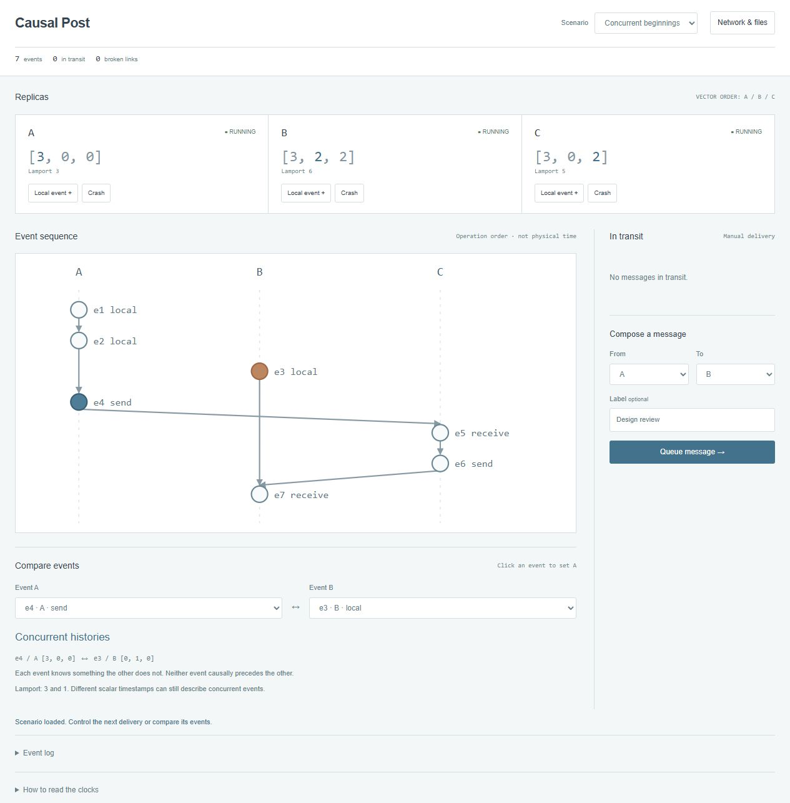

# Causal Post

A hands-on distributed-systems workbench for answering a deceptively simple question: did one event cause another, or did they happen independently?

Queue and reorder messages, partition directed links, pause replicas, and inspect vector and Lamport clocks side by side. Every scenario is an explicit command log that can be exported and replayed deterministically.



The main view includes one event lane per replica and arrows for recorded direct causal dependencies. Vertical position follows simulator operation order, not physical time. Click or keyboard-activate events to alternate comparison selections A and B. Queued messages and the composer sit beside the diagram; partitions and scenario files are in **Network & files**, and the full event log expands below.

## Run locally

Requires Python 3.10+ to serve the interface. No packages, build step, account, or API key.

```sh
python run.py --port 8000
```

Open http://127.0.0.1:8000. The server binds to loopback and serves only four allowlisted interface assets. The simulation runs in the browser; refreshing discards it unless you export a scenario first.

## Try these experiments

1. **Concurrent histories:** compare e2 and e3 in the initial scenario. Their Lamport timestamps differ, but neither vector dominates the other.
2. **A partitioned network:** m1 cannot arrive until you expand “Partition a directed link” and heal A → B. Healing restores the link; delivery remains an explicit action.
3. **Out-of-order delivery:** m2 has already arrived before m1. Deliver m1 and observe that B's knowledge of A never decreases.
4. **Replica recovery:** crash a receiver, observe that delivery is disabled, then recover it. Its clocks are retained.
5. **Replay:** export a scenario, start an empty one, and import the file to reconstruct the same events, messages, faults, and clocks.

## What the model implements

Each replica starts with a zero vector and scalar clock. A local or send event increments its own vector component and its Lamport clock. A message carries immutable snapshots of those clocks. A receive event merges vector components using `max`, increments the receiver's component, and sets its scalar clock to `max(local, message) + 1`.

An event happens before another when its vector is componentwise no greater and at least one component is smaller. Incomparable vectors represent concurrent events. Scalar timestamp ordering alone does not establish causality.

Each event also records its direct causal dependencies: the preceding event on that replica and, for a receive, the corresponding send event. This makes the clock calculation independently checkable against graph reachability.

Network controls are explicit: partitions are directed, messages may be dropped or delivered out of order, and recovery preserves clocks. A sender crashing after enqueueing does not destroy an in-flight message. Fault controls themselves are simulator commands, not replica events, so they do not increment clocks.

This is a deterministic logical-clock teaching model. It does not implement consensus, actual network transport, persistence after a browser refresh, wall-clock synchronization, or automatic message retries. “Crash” models a paused replica with retained state, not disk loss.

## Replay format

```json
{
  "format": "causal-post-v1",
  "nodes": ["A", "B", "C"],
  "commands": [
    {"type": "send", "from": "A", "to": "B", "label": "revision 1"},
    {"type": "deliver", "message": "m1"}
  ]
}
```

Commands: `local`, `send`, `deliver`, `drop`, `partition`, `heal`, `crash`, and `recover`. Exports contain labels you entered. Import validates and replays every command into a candidate simulator before replacing the current one. Invalid commands leave both state and command history unchanged.

The separate event-log export contains derived state for analysis; import accepts the replayable scenario format, not that derived log.

## Bounds and architecture

- 2–6 replicas, distinct uppercase single-letter identifiers.
- Up to 200 events, 100 messages, and 512 commands per scenario.
- Labels up to 120 characters; imported JSON up to 150,000 characters, with a 600 KB browser file limit and strict UTF-8 decoding.
- Event table paginated in batches of 50; the export retains all events.
- `core.js`: isolated simulator, validation, vector comparison, replay, and examples; no DOM dependencies.
- `app.js`: controls, accessible status announcements, clock inspection, file handling, and rendering.
- `run.py`: small local-only development server with an asset allowlist and restrictive content security policy. It is not a production server.

## Verification

Requires Node.js 22+ and Python 3.10+.

```sh
node --test
npm run check
python -m unittest discover -s tests -v
```

The 11 JavaScript tests cover message snapshots, merges, atomic failures, partitions, reordered delivery, recovery, replay, and resource bounds. A deterministic generated 100-event scenario checks all event pairs against independently computed graph ancestry. The Python server test checks the asset boundary, Host validation, and HEAD behavior. GitHub Actions runs Linux with Node 22/24 and Windows with Node 24.

Browser verification covers partition healing, delivery blocking during a crash, recovery, out-of-order arrival, and scenario export/import replay.

## Background

- [Leslie Lamport, Time, Clocks, and the Ordering of Events in a Distributed System (1978)](https://www.microsoft.com/en-us/research/wp-content/uploads/2016/12/Time-Clocks-and-the-Ordering-of-Events-in-a-Distributed-System.pdf)
- [University of Pennsylvania: Logical Clocks and Vector Clocks](https://www.cis.upenn.edu/~lee/07cis505/Lec/lec-ch6-synch2-LogicalClock-v2.pdf)
